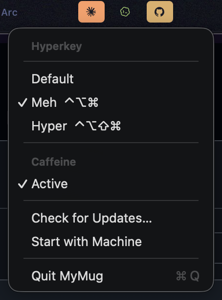

# MyMug

Menu bar app for macOS: **Caps Lock → Meh/Hyper** + **Caffeine**.



| Mode | Caps Lock |
|------|-----------|
| **Default** | Normal Caps Lock |
| **Meh** | Hold = ⌃⌥⌘, tap = Esc |
| **Hyper** | Hold = ⌃⌥⇧⌘, tap = Esc |

**Caffeine** keeps the display awake — filled mug in the menu bar when on, empty when off.

## Run

```bash
./build.sh
open build/MyMug.app
```

Grant **Accessibility** when asked.

Requires macOS 14+, Apple Silicon.
